<picture>
  <source media="(prefers-color-scheme: dark)" srcset="https://raw.githubusercontent.com/techwithkishan/Techwithkishan/main/dark.svg">
  <source media="(prefers-color-scheme: light)" srcset="https://raw.githubusercontent.com/techwithkishan/Techwithkishan/main/light.svg">
  
</picture>

## 👋 Hi, I'm Kishan

B.Tech student in **AI & ML** at **Baderia Global Institute of Engineering & Management (BGIEM), Jabalpur**, studying under the RGPV curriculum. I build projects and ship them publicly on GitHub.

## 🎯 Focus

- AI & Machine Learning (B.Tech coursework)
- React web apps, from Figma design to deployment
- Hackathons — currently preparing for **Smart India Hackathon 2026**

## 🧭 Roles & Community

| Role | Where |
| --- | --- |
| Tech Maestro | Microsoft Student Chapter, BGIEM |
| Outreach Manager | CodingEra |

## 🚀 Featured Projects

| Project | What it is | Built with |
| --- | --- | --- |
| **Chronos** | Academic timetable management system with an admin timetable grid and conflict detection, designed in Figma | React |
| **DriveLegal (DRIVOS)** | Traffic compliance portal with Google Sign-In | React, Firebase, Vercel |

## 🛠 Engineering Stack

**Frontend:** React  
**Backend / Cloud:** Firebase, Vercel  
**Design:** Figma  
**Tools:** Git, GitHub

## 📈 GitHub Activity

## 🔗 Connect

- GitHub: [github.com/techwithkishan](https://github.com/techwithkishan)
